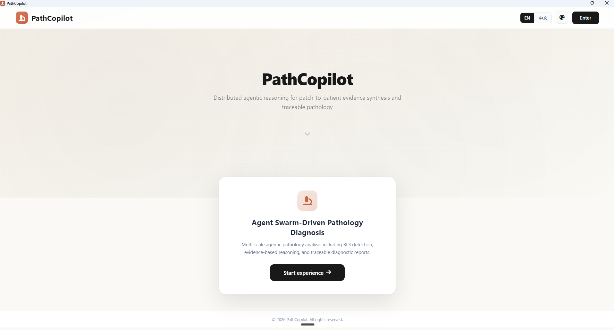
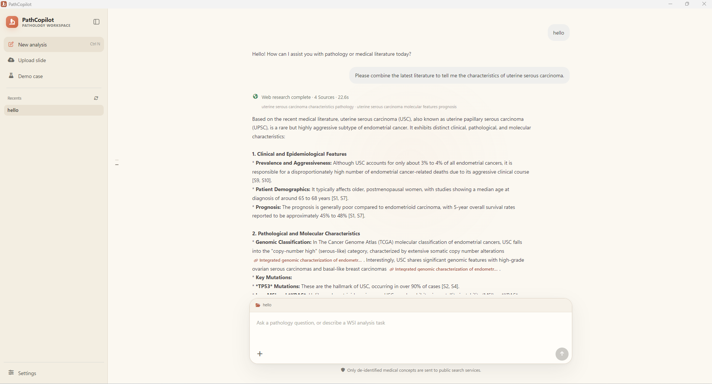
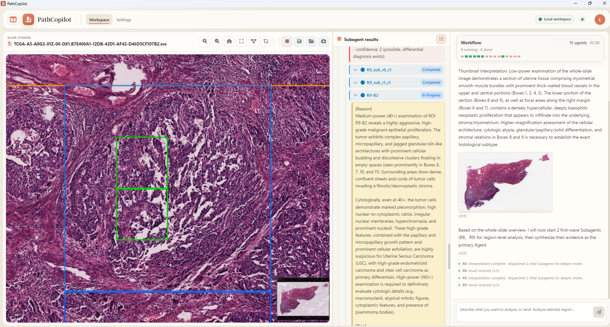
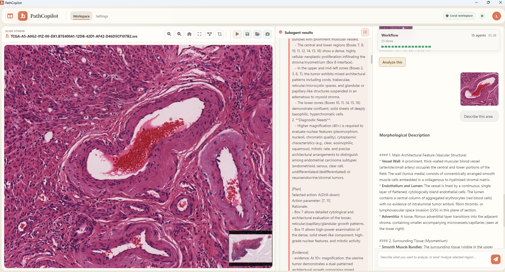

<div align="center" style="text-align: center;">

<p align="center"><strong>English</strong> | <a href="README_CN.md">简体中文</a></p>

<h1 align="center">PathCopilot</h1>

<h3 align="center">Distributed Agentic Reasoning for Patch-to-Patient Evidence Synthesis and Traceable Pathology</h3>

<p align="center"><a href="https://github.com/sunxinti/PathCopilot/releases"></a> <a href="instruction/README.md"></a> <a href="#citation"></a> <a href="LICENSE"></a></p>

<p align="center">
  
</p>

<p align="center">Overview of PathCopilot. <em>(Top)</em> Multi-scale agentic WSI analysis with patient-level multi-slide integration. <em>(Middle)</em> The Reason–Plan–Action–Memory loop executed by each sub-agent. <em>(Bottom-left)</em> Human–AI collaborative interface. <em>(Bottom-right)</em> Traceable pathology report with evidence-linked ROI coordinates.</p>

</div>

---

## Introduction

Pathological diagnosis remains the gold standard for clinical decision-making, yet its digital transformation is increasingly constrained by gigapixel-scale whole-slide images (WSIs) and the need to integrate evidence across regions, slides and anatomical parts. Here we present PathCopilot, an agent-swarm-driven distributed agentic framework for clinical pathology that formalizes slide reading as multiple parallel evidence-collection trajectories, each executed by sub-agents operating within an auditable Reason–Plan–Action–Memory loop. PathCopilot aggregates findings through a path tree and generates evidence-bound pathology reports in which each diagnostic statement is explicitly linked to its originating path, ROI coordinates and representative morphological evidence. Unlike conventional pathology foundation models that primarily support patch-level representation learning or isolated downstream tasks, PathCopilot supports hierarchical evidence synthesis across ROIs, slides and anatomical parts, and enables dynamic human–AI collaboration through an interactive Human–AI Feedback Loop (HAFL). We evaluated PathCopilot at three levels. Patch-level experiments on 744 PathMMU questions profiled human–AI complementarity and informed the choice of backbone model and the HAFL design. At the WSI level, PathCopilot under the AI-only condition achieved an overall accuracy above 80% in each of four cohorts comprising 1,693 diagnostic WSIs across three cancer types; on the MultiPathQA benchmark, it achieved the highest performance among the compared methods on three subsets and remained competitive on the other two. In a consecutive real-world cohort of 20 endometrial carcinoma patients (413 WSIs) from Peking Union Medical College Hospital, the HAFL workflow attained a geometric composite score of 0.876, compared with 0.668 for AI-only and 0.760 for human-only workflows. Overall, PathCopilot provides a scalable, transparent and practically useful framework for evidence-grounded clinical reasoning in digital pathology.

## Desktop application

PathCopilot can run entirely on the user's computer. The self-contained EXE is a Windows convenience package; the openly released Python Web application can run on Windows, Linux or macOS and does not depend on the EXE or a proprietary online service.



### Windows installer

> 🎉 **[NEW] 2026.11.22 — PathCopilot Desktop v2.0.5 released!**<br>
> PathCopilot is now available as a standalone Windows desktop application.<br>
> **Download:** [PathCopilot-Setup-2.0.5-x64.exe](https://github.com/sunxinti/PathCopilot/releases/download/v2.0.5/PathCopilot-Setup-2.0.5-x64.exe).<br>
> Includes Electron, portable Python 3.11, OpenSlide and one public TCGA demonstration WSI. No Python, Node.js or server setup is required.

### Cross-platform Python workspace

All code required to inspect, run and modify the local Web application is under `application-cmd/`. After installing Python 3.11, the module can be started directly on any supported desktop operating system:

```bash
cd application-cmd
python3.11 -m venv .venv
source .venv/bin/activate        # Linux / macOS
python -m pip install -r webapp/requirements.txt
python webapp/_start.py
```

Install the native OpenSlide library first on Linux or macOS, for example with `apt install openslide-tools` or `brew install openslide`.

Windows users can use the included convenience scripts instead of typing the commands manually:

```cmd
cd application-cmd
setup.cmd
start.cmd
```

`setup.cmd` creates a Python 3.11 virtual environment and installs the Windows OpenSlide runtime. `start.cmd` keeps the local server visible in a terminal and opens [http://127.0.0.1:5000/workspace](http://127.0.0.1:5000/workspace). It does not call or wrap the desktop EXE. See [`application-cmd/README.md`](application-cmd/README.md).

In every source-based route, PathCopilot runs as a local Flask service and is opened through the user's browser. No closed backend is required. The only excluded materials are credentials, patient data, downloaded WSIs, generated outputs, caches and internal development tests.

Both desktop routes require the user to configure an OpenAI-compatible endpoint, model identifier and their own API key in **Settings**.

🚀 PathCopilot implements many interesting features. For a complete illustrated walkthrough, see the [English user guide](instruction/README.md).

**Evidence-grounded literature retrieval**



**Traceable multiscale WSI analysis**



**User-defined ROI review**



❤️ We invite you to explore PathCopilot! The complete project source code is openly available in this repository. If you encounter any problems, please open an Issue, suggest improvements, or build upon the project for research purposes.

## Evaluation datasets and official sources


| Level      | Dataset/cohort                              | Frozen public scope             | Official source                                                                                                                          |
| ---------- | ------------------------------------------- | ------------------------------- | ---------------------------------------------------------------------------------------------------------------------------------------- |
| Patch      | PathMMU Atlas, EduContent and PubMed subset | 744 questions                   | [Hugging Face](https://huggingface.co/datasets/jamessyx/PathMMU) and [official repository](https://github.com/PathMMU-Benchmark/PathMMU) |
| WSI QA     | MultiPathQA                                 | 934 questions / 862 unique WSIs | [Hugging Face](https://huggingface.co/datasets/tbuckley/MultiPathQA)                                                                     |
| WSI cohort | TCGA-UCEC                                   | 562 WSIs                        | [NCI Genomic Data Commons](https://portal.gdc.cancer.gov/projects/TCGA-UCEC)                                                             |
| WSI cohort | TCGA-COAD                                   | 455 WSIs                        | [NCI Genomic Data Commons](https://portal.gdc.cancer.gov/projects/TCGA-COAD)                                                             |
| WSI cohort | TCGA-LUAD                                   | 541 WSIs                        | [NCI Genomic Data Commons](https://portal.gdc.cancer.gov/projects/TCGA-LUAD)                                                             |
| WSI cohort | CPTAC-UCEC                                  | 135 WSIs / 95 patients          | [The Cancer Imaging Archive](https://www.cancerimagingarchive.net/collection/cptac-ucec/)                                                |
| Patient    | PUMCH institutional cohort                  | Data not redistributed          | Peking Union Medical College Hospital; access requires applicable ethics approval and a data-use agreement                               |


Dataset files and WSIs are not bundled. PathMMU access is controlled by its
maintainers, and MultiPathQA references WSIs hosted by several source
repositories. Users can obtain these datasets from the official links above.

See [`data_download/README.md`](data_download/README.md) for data availability,
source terms, exact frozen TCGA/CPTAC identifiers, download commands and expected
layouts. Dedicated guides are also provided for
[PathMMU](data_download/pathmmu/README.md) and
[MultiPathQA](data_download/multipathqa/README.md). The PUMCH evaluation ships
only runnable code; institutional slides and case-level source data are not
included.

### Data access and frozen identifiers

Exact TCGA/CPTAC slide IDs and SVS file names are under
[`data_download/ids/`](data_download/ids/). GDC and TCIA validation/download
helpers are under [`data_download/scripts/`](data_download/scripts/). Review the
generated resolution audit before downloading any WSI. Complete Linux and
Windows commands are maintained in the central
[data guide](data_download/README.md).

## Patch-level evaluation: PathMMU

Install dependencies and provide an OpenRouter key:

```bash
python -m pip install -r evaluation/patch_level/requirements.txt
export OPENROUTER_API_KEY="your-openrouter-key"
```

Run a smoke test:

```bash
python evaluation/patch_level/eval_pathmmu.py \
  --data_path /path/to/pathmmu_data \
  --category pdv \
  --limit 50
```

See [`evaluation/patch_level/README.md`](evaluation/patch_level/README.md) for
the complete subset and resume options.

## WSI-level evaluation: MultiPathQA

```bash
python -m pip install -r evaluation/wsi_level_MultiPathQA/requirements.txt
export OPENROUTER_API_KEY="your-openrouter-key"

python evaluation/wsi_level_MultiPathQA/run_multipathqa_eval.py \
  --csv /path/to/MultiPathQA.csv \
  --img_dir /path/to/multipathqa_wsi \
  --benchmark tcga_expert_vqa \
  --provider openrouter \
  --lang en
```

The benchmark keeps its original label isolation, 1-based option mapping and
legacy relative-FOV routing identifiers. See
[`evaluation/wsi_level_MultiPathQA/README.md`](evaluation/wsi_level_MultiPathQA/README.md).

## Cancer-specific TCGA cohorts

The unified runner selects a cancer-specific prompt profile:

```bash
python -m pip install -r evaluation/wsi_level_TCGA_cohort/requirements.txt
export OPENROUTER_API_KEYS="your-openrouter-key"

python evaluation/wsi_level_TCGA_cohort/run_fulleval.py \
  --cancer coad \
  --svs_dir /path/to/TCGA-COAD-svs \
  --slide_list data_download/ids/tcga_coad_svs_files.txt \
  --provider openrouter \
  --lang zh
```

Use `--cancer ucec`, `coad` or `luad` only with its matching frozen cohort
list. See
[`evaluation/wsi_level_TCGA_cohort/README.md`](evaluation/wsi_level_TCGA_cohort/README.md).

## Supervised MIL baselines (TCGA-UCEC)

Supervised multiple-instance learning baselines on the six TCGA-UCEC questions
combine three frozen pathology encoders (CONCH, UNI, Virchow2) with three
aggregators (mean pooling, ABMIL, CLAM-SB), trained with patient-level 5-fold
cross-validation and seeds 0, 1 and 2, in fully supervised and one-shot
settings. The TCGA-trained models are then applied to CPTAC-UCEC without
retraining:

```bash
python -m pip install -r evaluation/wsi_level_MIL_baseline/requirements.txt
git clone https://github.com/mahmoodlab/CLAM.git

MIL_ROOT=/path/to/mil_workdir CLAM_ROOT=/path/to/CLAM LABELS=tcga_ucec \
  bash evaluation/wsi_level_MIL_baseline/run_mil_baseline.sh
```

Only code is provided; labels, fold assignments, features and model weights
are not distributed. See
[`evaluation/wsi_level_MIL_baseline/README.md`](evaluation/wsi_level_MIL_baseline/README.md).

## Patient-level PUMCH evaluation

The public patient-level runner accepts a de-identified manifest and supports
parallel or sequential WSI scheduling:

```bash
python -m pip install -r evaluation/patient_level_PUMCH/requirements.txt
export OPENROUTER_API_KEYS="your-openrouter-key"

python evaluation/patient_level_PUMCH/run_pumch_eval.py \
  --manifest /path/to/patients.json \
  --wsi-schedule parallel \
  --lang zh \
  --events
```

PUMCH slides, patient identifiers, case databases and reports are not included.
Qualified access requests are handled by the corresponding author under
applicable ethics approval and data-use agreements. See
[`evaluation/patient_level_PUMCH/README.md`](evaluation/patient_level_PUMCH/README.md).

## Repository structure

```text
PathCopilot/
├── README.md / README_CN.md                 # English / Chinese project entry
├── LICENSE                                  # MIT source-code license
├── .gitignore / .gitattributes              # Publication and large-file rules
├── assets/                                  # Figures used by the root README
│   ├── framework-v3.jpg                     # Paper framework overview
│   └── desktop-welcome.png                  # Local desktop workspace
├── data_download/
│   ├── README.md                            # Central data availability guide
│   ├── ids/
│   │   ├── cohort_summary.tsv               # Frozen analytic cohort counts
│   │   ├── tcga_*_slide_ids.txt             # Public TCGA submitter IDs
│   │   ├── tcga_*_svs_files.txt             # Exact TCGA SVS file names
│   │   └── cptac_ucec_download_manifest.tsv # Frozen TCIA URLs and identifiers
│   ├── pathmmu/README.md                    # Gated PathMMU access and layout
│   ├── multipathqa/README.md                # CSV and source-WSI provenance
│   └── scripts/
│       ├── gdc_download.py                  # Resolve TCGA names through GDC
│       ├── cptac_download.py                # Validate/download CPTAC-UCEC
│       └── download_*.sh / *.ps1            # Linux/Windows cohort wrappers
├── evaluation/
│   ├── patch_level/
│   │   ├── eval_pathmmu.py                  # PathMMU public evaluator
│   │   ├── requirements.txt
│   │   └── README.md
│   ├── wsi_level_MultiPathQA/
│   │   ├── run_multipathqa_eval.py          # Fixed single-question runner
│   │   ├── app.py / evaluation_runtime.py   # Headless WSI registry + Runtime bridge
│   │   ├── agent/                           # Frozen benchmark Agent/prompts
│   │   ├── pathcopilot_agent/               # Agent identity/projection layer
│   │   ├── pathcopilot_runtime/             # Durable local Runtime
│   │   ├── requirements.txt
│   │   └── README.md / AGENT_RUNTIME.md
│   ├── wsi_level_TCGA_cohort/
│   │   ├── run_fulleval.py                  # UCEC/COAD/LUAD cohort entry
│   │   ├── agent/                           # Cancer profiles and prompt blocks
│   │   ├── common/                          # Batch Runtime and outbound MCP
│   │   ├── pathcopilot_agent/
│   │   ├── pathcopilot_runtime/
│   │   ├── mcp.outbound.json
│   │   ├── requirements.txt
│   │   └── README.md
│   ├── wsi_level_MIL_baseline/
│   │   ├── run_mil_baseline.sh              # Seeds 0-2: full, one-shot, CPTAC inference
│   │   ├── train_mil.py / train_oneshot.py  # Patient-level 5-fold MIL training
│   │   ├── predict_external.py              # Apply TCGA-trained models to CPTAC-UCEC
│   │   ├── make_labels.py / make_folds.py   # Label encoding and patient-level folds
│   │   ├── build_coord_manifest.py          # CLAM coordinates per slide
│   │   ├── extract_features.py              # CONCH/UNI features, tolerant of bad tiles
│   │   ├── mil_common.py                    # Paths, feature loading and models
│   │   ├── requirements.txt
│   │   └── README.md
│   └── patient_level_PUMCH/
│       ├── run_pumch_eval.py                # De-identified patient manifest runner
│       ├── patient_runtime.py               # Multi-WSI scheduling/projection
│       ├── agent/                           # Patient-level Agent and synthesis
│       ├── common/                          # Outbound MCP/search helpers
│       ├── pathcopilot_agent/
│       ├── pathcopilot_runtime/
│       ├── mcp.outbound.json
│       ├── requirements.txt
│       └── README.md
├── instruction/
│   ├── README.md / README_zh.md              # English / Chinese user guide
│   └── images/                               # Full-resolution guide screenshots
├── application-cmd/
│   ├── setup.cmd / start.cmd                # Windows setup and local launch
│   ├── requirements-windows.txt             # Python + Windows OpenSlide
│   ├── mcp.outbound.json / OUTBOUND_MCP.md  # Product outbound MCP boundary
│   ├── webapp/
│   │   ├── _start.py / app.py               # Cross-platform Flask entry/backend
│   │   ├── agent/                           # Agent Loop, prompts and reports
│   │   ├── pathcopilot_agent/               # Public Agent service/identity model
│   │   ├── pathcopilot_runtime/             # Runtime, scheduler, events and SQL
│   │   ├── pathcopilot_mcp/                 # Inbound MCP server
│   │   ├── pathcopilot_outbound_mcp/        # PubMed MCP client/server
│   │   ├── static/ / templates/             # Complete browser frontend
│   │   └── requirements.txt
│   └── README.md / SECURITY.md
└── desktop/
    ├── README.md                            # Installer and privacy instructions
    └── SHA256SUMS.txt                       # Release-asset integrity hash
```

The local installer under `desktop/` is ignored by Git and must be uploaded as
a GitHub Release asset.

### Component index


| Component                    | Primary entry point                                        | Purpose                                                                 |
| ---------------------------- | ---------------------------------------------------------- | ----------------------------------------------------------------------- |
| Patch-level evaluation       | `evaluation/patch_level/eval_pathmmu.py`                   | Reproduce the frozen 744-question PathMMU subset                        |
| MultiPathQA evaluation       | `evaluation/wsi_level_MultiPathQA/run_multipathqa_eval.py` | Run label-isolated, single-question WSI evaluation                      |
| TCGA cohort evaluation       | `evaluation/wsi_level_TCGA_cohort/run_fulleval.py`         | Run the matching UCEC, COAD or LUAD prompt profile over a frozen cohort |
| Supervised MIL baselines     | `evaluation/wsi_level_MIL_baseline/run_mil_baseline.sh`    | Train CONCH/UNI/Virchow2 MIL baselines on TCGA-UCEC, apply to CPTAC     |
| PUMCH patient evaluation     | `evaluation/patient_level_PUMCH/run_pumch_eval.py`         | Analyze a de-identified multi-slide patient manifest                    |
| Local Web application        | `application-cmd/webapp/_start.py`                         | Start the complete Flask WSI workspace on Windows, Linux or macOS       |
| Windows convenience launcher | `application-cmd/start.cmd`                                | Start the same open-source Web application from CMD                     |
| Data preparation             | `data_download/README.md`                                  | Obtain datasets and resolve exact public WSI identifiers                |
| User guide                   | `instruction/README.md`                                    | Configure providers and use analysis/report/ROI features                |
| Windows installer            | GitHub Release asset                                       | Run the prebuilt Electron/Python/OpenSlide client                       |


## Privacy and security

- Never commit API keys, tokens, `.env` files or local settings databases.
- Keep downloaded WSIs and generated DZI tiles outside Git.
- De-identify clinical material before using an external model provider.
- Confirm provider data-processing terms before transmitting images or prompts.
- Dependencies, datasets and model services retain their own licenses and terms.


## Citation

> Paper citation and DOI will be added after publication.


## License

PathCopilot source code in this repository is released under the
[MIT License](LICENSE). Datasets, model services, third-party dependencies and
reference materials remain subject to their own terms.

## Contact

PathCopilot is developed by the
[Long Lab](https://sites.google.com/view/erping-long-lab/) at the Institute of
Basic Medical Sciences, Chinese Academy of Medical Sciences & Peking Union
Medical College, together with the Department of Pathology, Peking Union
Medical College Hospital.


| Author            | Role                   | Email                                                               |
| ----------------- | ---------------------- | ------------------------------------------------------------------- |
| Xinti Sun         | Ph.D. Candidate        | [sunxinti@tmu.edu.cn](mailto:sunxinti@tmu.edu.cn)                   |
| Yinbo Xiao        | Pathologist            | [xiaoyinbo@pumch.cn](mailto:xiaoyinbo@pumch.cn)                     |
| Erping Long       | Principal Investigator | [erping.long@ibms.pumc.edu.cn](mailto:erping.long@ibms.pumc.edu.cn) |
