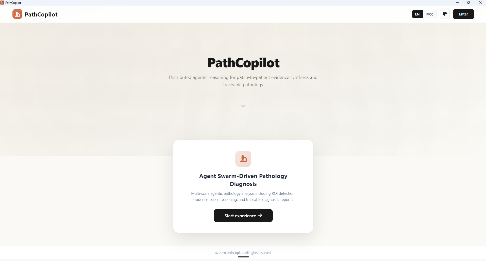
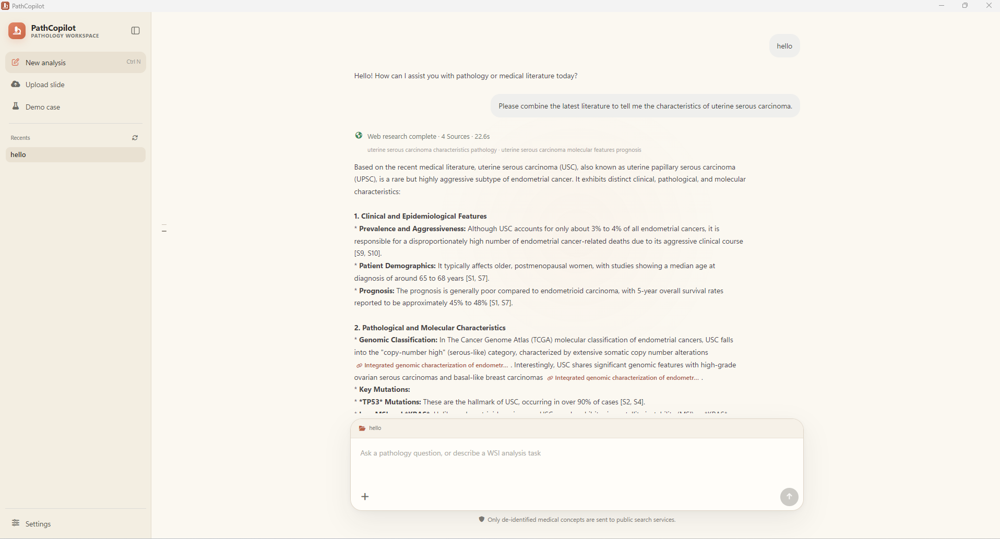
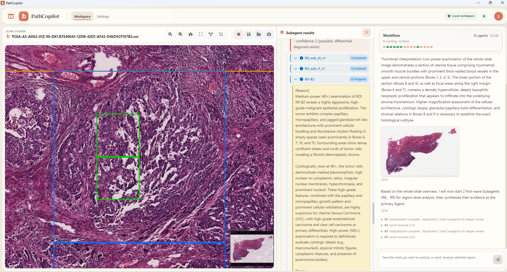
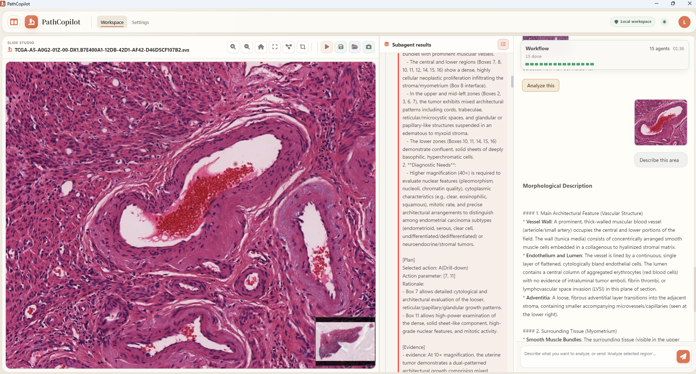

<div align="center" style="text-align: center;">

<p align="center"><a href="README.md">English</a> | <strong>简体中文</strong></p>

<h1 align="center">PathCopilot</h1>

<h3 align="center">从图像块到患者级证据综合与可追溯病理推理的分布式智能体框架</h3>

<p align="center"><a href="https://github.com/sunxinti/PathCopilot/releases"></a> <a href="instruction/README_zh.md"></a> <a href="#引用"></a> <a href="LICENSE"></a></p>

<p align="center">
  
</p>

<p align="center">PathCopilot概览。<em>（顶部）</em> 多尺度智能体WSI分析与患者级多切片整合。<em>（中部）</em> 每个子智能体执行的“推理–计划–行动–记忆”循环。<em>（左下）</em> 人机协作界面。<em>（右下）</em> 具有证据关联ROI坐标的可追溯病理报告。</p>

</div>

---

## 引言

病理诊断仍是临床决策的金标准，但其数字化转型日益受到十亿像素级全视野切片（WSI）以及跨区域、跨切片和跨解剖部位证据整合需求的制约。我们提出PathCopilot：一种面向临床病理、由智能体群驱动的分布式智能体框架，将阅片过程形式化为多条并行的证据采集轨迹，每条轨迹均由子智能体在可审计的“推理–计划–行动–记忆”循环中执行。PathCopilot通过路径树汇总分析结果并生成证据绑定的病理报告，其中每项诊断陈述均明确关联至其来源路径、ROI坐标及代表性形态学证据。不同于主要支持图像块级表征学习或孤立下游任务的传统病理基础模型，PathCopilot支持跨ROI、切片和解剖部位的分层证据综合，并通过交互式人机反馈闭环（HAFL）实现动态人机协作。我们在三个层级评估了PathCopilot。图像块级实验基于PathMMU的744道题，刻画了人与AI的互补性，并为骨干模型选择和HAFL设计提供依据。在WSI级，PathCopilot在单独AI条件下，于涵盖三种癌种、共1,693张诊断性WSI的四个队列中总体准确率均超过80%；在MultiPathQA基准上，于三个子集取得所比较方法中的最高性能，在另两个子集上表现相当。在北京协和医院连续入组的20例子宫内膜癌患者（413张WSI）真实世界队列中，HAFL工作流的几何综合评分为0.876，单独AI和单独人工工作流分别为0.668和0.760。总体而言，PathCopilot为数字病理中基于证据的临床推理提供了一个可扩展、透明且具有实际应用价值的框架。

## 桌面应用

PathCopilot可以完全运行在用户自己的电脑上。预编译EXE是Windows便捷安装包；公开的Python Web应用源码可以在Windows、Linux和macOS运行，不依赖EXE、在线网站或闭源后端。



### Windows安装包

> 🎉 **[NEW] 2026.11.22 — PathCopilot Desktop v2.0.5 已发布！**<br>
> PathCopilot现已提供Windows独立桌面应用。<br>
> **下载：**[PathCopilot-Setup-2.0.5-x64.exe](https://github.com/sunxinti/PathCopilot/releases/download/v2.0.5/PathCopilot-Setup-2.0.5-x64.exe)。<br>
> 安装包包含Electron、便携Python 3.11、OpenSlide和一张公共TCGA演示WSI，无需安装Python、Node.js或配置服务器。

### 跨平台Python本地工作台

运行、检查和修改本地Web应用所需的核心源码均位于`application-cmd/`。安装Python 3.11后，可以在支持的桌面操作系统中直接启动：

```bash
cd application-cmd
python3.11 -m venv .venv
source .venv/bin/activate        # Linux / macOS
python -m pip install -r webapp/requirements.txt
python webapp/_start.py
```

Linux和macOS需要先安装系统OpenSlide库，例如：

```bash
sudo apt-get install openslide-tools   # Ubuntu / Debian
brew install openslide                 # macOS
```

Windows用户可以直接使用便捷脚本：

```cmd
cd application-cmd
setup.cmd
start.cmd
```

`setup.cmd`创建Python 3.11虚拟环境并安装Windows OpenSlide运行库；`start.cmd`在可见终端中启动本地服务并打开[http://127.0.0.1:5000/workspace](http://127.0.0.1:5000/workspace)。它不会调用或包装桌面EXE。详细说明见[`application-cmd/README.md`](application-cmd/README.md)。

无论采用哪种源码启动方式，PathCopilot都会作为本地Flask服务运行，并通过用户浏览器打开。无需任何闭源后端。仓库仅排除凭据、患者数据、下载的WSI、运行输出、缓存和内部开发测试。

EXE和源码工作台都需要用户在 **Settings** 中自行配置OpenAI兼容Endpoint、模型名称和API Key。

🚀 PathCopilot 实现了许多有趣的功能，完整图文操作说明见[中文简易指南](instruction/README_zh.md)。

**基于证据的病理文献检索**



**可追溯的多尺度 WSI 分析**



**用户自定义 ROI 复核**




❤️ 欢迎探索 PathCopilot！本仓库已完整公开项目源码。如在使用过程中遇到问题，欢迎提交 Issue、提出改进建议，或基于本项目开展科研用途的二次开发。

## 评测数据与官方来源


| 层级      | 数据集/队列                            | 冻结公开范围           | 官方来源                                                                                                                  |
| ------- | --------------------------------- | ---------------- | --------------------------------------------------------------------------------------------------------------------- |
| Patch   | PathMMU Atlas、EduContent和PubMed子集 | 744题             | [Hugging Face](https://huggingface.co/datasets/jamessyx/PathMMU)与[官方仓库](https://github.com/PathMMU-Benchmark/PathMMU) |
| WSI问答   | MultiPathQA                       | 934题 / 862张唯一WSI | [Hugging Face](https://huggingface.co/datasets/tbuckley/MultiPathQA)                                                  |
| WSI队列   | TCGA-UCEC                         | 562张WSI          | [NCI Genomic Data Commons](https://portal.gdc.cancer.gov/projects/TCGA-UCEC)                                          |
| WSI队列   | TCGA-COAD                         | 455张WSI          | [NCI Genomic Data Commons](https://portal.gdc.cancer.gov/projects/TCGA-COAD)                                          |
| WSI队列   | TCGA-LUAD                         | 541张WSI          | [NCI Genomic Data Commons](https://portal.gdc.cancer.gov/projects/TCGA-LUAD)                                          |
| WSI队列   | CPTAC-UCEC                        | 135张WSI / 95名患者  | [The Cancer Imaging Archive](https://www.cancerimagingarchive.net/collection/cptac-ucec/)                             |
| Patient | PUMCH院内队列                         | 不重新分发数据          | 北京协和医院；访问需符合相应伦理审批和数据使用协议                                                                                             |


仓库不包含数据集文件或WSI。PathMMU的访问由其维护者审批；MultiPathQA涉及 多个来源仓库中的WSI。您可以在提供的链接进行下载使用。

数据可用性、来源条款、冻结的TCGA/CPTAC标识、下载命令和目录格式详见
[`data_download/README.md`](data_download/README.md)。仓库还提供独立的
[PathMMU说明](data_download/pathmmu/README.md)和
[MultiPathQA说明](data_download/multipathqa/README.md)。PUMCH部分只公开可运行评测代码，不包含院内切片和病例级源数据。

### 数据获取与冻结标识

精确的TCGA/CPTAC slide ID和SVS文件名位于
[`data_download/ids/`](data_download/ids/)，GDC和TCIA验证/下载工具位于
[`data_download/scripts/`](data_download/scripts/)。下载WSI前应先检查解析审计； 完整的Linux与Windows命令在[数据总说明](data_download/README.md)中维护。

## Patch-level评测：PathMMU

安装依赖并设置OpenRouter Key：

```bash
python -m pip install -r evaluation/patch_level/requirements.txt
export OPENROUTER_API_KEY="your-openrouter-key"
```

运行一个Smoke Test：

```bash
python evaluation/patch_level/eval_pathmmu.py \
  --data_path /path/to/pathmmu_data \
  --category pdv \
  --limit 50
```

完整子集和断点续跑参数见
[`evaluation/patch_level/README.md`](evaluation/patch_level/README.md)。

## WSI-level评测：MultiPathQA

```bash
python -m pip install -r evaluation/wsi_level_MultiPathQA/requirements.txt
export OPENROUTER_API_KEY="your-openrouter-key"

python evaluation/wsi_level_MultiPathQA/run_multipathqa_eval.py \
  --csv /path/to/MultiPathQA.csv \
  --img_dir /path/to/multipathqa_wsi \
  --benchmark tcga_expert_vqa \
  --provider openrouter \
  --lang en
```

该评测保留原始标签隔离、从1开始的选项映射和旧版相对FOV路由标识。详细协议见
[`evaluation/wsi_level_MultiPathQA/README.md`](evaluation/wsi_level_MultiPathQA/README.md)。

## 癌种特异性TCGA队列

统一入口会根据癌种加载癌种特异提示词：

```bash
python -m pip install -r evaluation/wsi_level_TCGA_cohort/requirements.txt
export OPENROUTER_API_KEYS="your-openrouter-key"

python evaluation/wsi_level_TCGA_cohort/run_fulleval.py \
  --cancer coad \
  --svs_dir /path/to/TCGA-COAD-svs \
  --slide_list data_download/ids/tcga_coad_svs_files.txt \
  --provider openrouter \
  --lang zh
```

`--cancer ucec`、`coad`或`luad`必须与相应的冻结队列清单匹配。详细说明见
[`evaluation/wsi_level_TCGA_cohort/README.md`](evaluation/wsi_level_TCGA_cohort/README.md)。

## 有监督MIL基线（TCGA-UCEC）

在TCGA-UCEC的六个问题上，将三种冻结的病理基础模型编码器（CONCH、UNI、Virchow2）与三种聚合器
（mean pooling、ABMIL、CLAM-SB）组合，采用患者级五折交叉验证和种子0、1、2，分别训练全监督和
one-shot模型；TCGA训练的模型不经重新训练直接应用于CPTAC-UCEC：

```bash
python -m pip install -r evaluation/wsi_level_MIL_baseline/requirements.txt
git clone https://github.com/mahmoodlab/CLAM.git

MIL_ROOT=/path/to/mil_workdir CLAM_ROOT=/path/to/CLAM LABELS=tcga_ucec \
  bash evaluation/wsi_level_MIL_baseline/run_mil_baseline.sh
```

此处只提供代码，不包含标签、折划分、特征和模型权重。详细说明见
[`evaluation/wsi_level_MIL_baseline/README.md`](evaluation/wsi_level_MIL_baseline/README.md)。

## PUMCH Patient-level评测

公开的患者级入口读取去标识化manifest，支持并行或串行WSI调度：

```bash
python -m pip install -r evaluation/patient_level_PUMCH/requirements.txt
export OPENROUTER_API_KEYS="your-openrouter-key"

python evaluation/patient_level_PUMCH/run_pumch_eval.py \
  --manifest /path/to/patients.json \
  --wsi-schedule parallel \
  --lang zh \
  --events
```

仓库不包含PUMCH切片、患者标识、病例数据库或报告。有正当研究需求的研究者可在
相应伦理审批和数据使用协议下联系论文通讯作者申请访问。详细说明见
[`evaluation/patient_level_PUMCH/README.md`](evaluation/patient_level_PUMCH/README.md)。

## 仓库结构

```text
PathCopilot/
├── README.md / README_CN.md                 # 英文/中文项目入口
├── LICENSE                                  # MIT源码许可证
├── .gitignore / .gitattributes              # 发布和大文件规则
├── assets/                                  # 根README展示图片
│   ├── framework-v3.jpg                     # 论文框架总图
│   └── desktop-welcome.png                  # 本地桌面工作台
├── data_download/
│   ├── README.md                            # 数据可用性总说明
│   ├── ids/
│   │   ├── cohort_summary.tsv               # 冻结分析队列计数
│   │   ├── tcga_*_slide_ids.txt             # 公共TCGA提交ID
│   │   ├── tcga_*_svs_files.txt             # 精确TCGA SVS文件名
│   │   └── cptac_ucec_download_manifest.tsv # 冻结TCIA网址和标识
│   ├── pathmmu/README.md                    # PathMMU申请与目录格式
│   ├── multipathqa/README.md                # CSV及源WSI来源说明
│   └── scripts/
│       ├── gdc_download.py                  # 通过GDC解析TCGA文件
│       ├── cptac_download.py                # 验证/下载CPTAC-UCEC
│       └── download_*.sh / *.ps1            # Linux/Windows下载包装脚本
├── evaluation/
│   ├── patch_level/
│   │   ├── eval_pathmmu.py                  # PathMMU公开评测入口
│   │   ├── requirements.txt
│   │   └── README.md
│   ├── wsi_level_MultiPathQA/
│   │   ├── run_multipathqa_eval.py          # 冻结单问题评测入口
│   │   ├── app.py / evaluation_runtime.py   # 无头WSI注册表与Runtime桥
│   │   ├── agent/                           # 冻结评测Agent和提示词
│   │   ├── pathcopilot_agent/               # Agent身份与投影层
│   │   ├── pathcopilot_runtime/             # 本地持久化Runtime
│   │   ├── requirements.txt
│   │   └── README.md / AGENT_RUNTIME.md
│   ├── wsi_level_TCGA_cohort/
│   │   ├── run_fulleval.py                  # UCEC/COAD/LUAD统一入口
│   │   ├── agent/                           # 癌种配置与提示词块
│   │   ├── common/                          # 批量Runtime和出站MCP
│   │   ├── pathcopilot_agent/
│   │   ├── pathcopilot_runtime/
│   │   ├── mcp.outbound.json
│   │   ├── requirements.txt
│   │   └── README.md
│   ├── wsi_level_MIL_baseline/
│   │   ├── run_mil_baseline.sh              # 种子0-2：全监督、one-shot、CPTAC推理
│   │   ├── train_mil.py / train_oneshot.py  # 患者级五折MIL训练
│   │   ├── predict_external.py              # TCGA模型应用于CPTAC-UCEC
│   │   ├── make_labels.py / make_folds.py   # 标签编码与患者级折划分
│   │   ├── build_coord_manifest.py          # 每张切片的CLAM坐标
│   │   ├── extract_features.py              # CONCH/UNI特征，跳过损坏tile
│   │   ├── mil_common.py                    # 路径、特征读取与模型
│   │   ├── requirements.txt
│   │   └── README.md
│   └── patient_level_PUMCH/
│       ├── run_pumch_eval.py                # 去标识化Patient manifest入口
│       ├── patient_runtime.py               # 多WSI调度和投影
│       ├── agent/                           # Patient Agent与综合
│       ├── common/                          # 出站MCP与检索辅助
│       ├── pathcopilot_agent/
│       ├── pathcopilot_runtime/
│       ├── mcp.outbound.json
│       ├── requirements.txt
│       └── README.md
├── instruction/
│   ├── README.md / README_zh.md              # 英文/中文用户指南
│   └── images/                               # 原始清晰度操作截图
├── application-cmd/
│   ├── setup.cmd / start.cmd                # Windows安装与本地启动
│   ├── requirements-windows.txt             # Python及Windows OpenSlide
│   ├── mcp.outbound.json / OUTBOUND_MCP.md  # 产品出站MCP边界
│   ├── webapp/
│   │   ├── _start.py / app.py               # 跨平台Flask入口与后端
│   │   ├── agent/                           # Agent Loop、提示词和报告
│   │   ├── pathcopilot_agent/               # Agent服务与身份模型
│   │   ├── pathcopilot_runtime/             # Runtime、调度、事件和SQL
│   │   ├── pathcopilot_mcp/                 # 入站MCP服务
│   │   ├── pathcopilot_outbound_mcp/        # PubMed MCP客户端/服务端
│   │   ├── static/ / templates/             # 完整浏览器前端
│   │   └── requirements.txt
│   └── README.md / SECURITY.md
└── desktop/
    ├── README.md                            # 安装与隐私说明
    └── SHA256SUMS.txt                       # Release附件完整性校验
```

`desktop/`中的本地安装包由Git忽略，应作为GitHub Release附件上传。

### 组件入口索引


| 组件              | 主入口                                                        | 用途                                   |
| --------------- | ---------------------------------------------------------- | ------------------------------------ |
| Patch-level评测   | `evaluation/patch_level/eval_pathmmu.py`                   | 复现冻结的744题PathMMU子集                   |
| MultiPathQA评测   | `evaluation/wsi_level_MultiPathQA/run_multipathqa_eval.py` | 执行标签隔离的单问题WSI评测                      |
| TCGA队列评测        | `evaluation/wsi_level_TCGA_cohort/run_fulleval.py`         | 对冻结队列运行匹配的UCEC、COAD或LUAD提示词          |
| 有监督MIL基线       | `evaluation/wsi_level_MIL_baseline/run_mil_baseline.sh`    | 在TCGA-UCEC上训练MIL基线并应用于CPTAC-UCEC          |
| PUMCH Patient评测 | `evaluation/patient_level_PUMCH/run_pumch_eval.py`         | 分析去标识化的多切片Patient manifest           |
| 本地Web应用         | `application-cmd/webapp/_start.py`                         | 在Windows、Linux或macOS启动完整Flask WSI工作台 |
| Windows便捷入口     | `application-cmd/start.cmd`                                | 从CMD启动同一开源Web应用                      |
| 数据准备            | `data_download/README.md`                                  | 获取数据并解析准确公共WSI标识                     |
| 用户指南            | `instruction/README_zh.md`                                 | 配置模型并使用分析、报告和ROI功能                   |
| Windows安装包      | GitHub Release附件                                           | 运行预构建Electron/Python/OpenSlide客户端    |


## 隐私与安全

- 请不要提交API Key、Token、`.env`文件或本地设置数据库；
- 下载的WSI和生成的DZI不得进入Git；
- 使用外部模型服务前应对临床材料去标识化；
- 传输图片或提示词前确认模型服务商的数据处理条款；
- 依赖、数据集和模型服务仍受各自许可证和条款约束。


## 引用

> 论文正式发表后补充引用信息和DOI。


## 许可证

本仓库中的PathCopilot源码采用[MIT License](LICENSE)发布。数据集、模型服务、
第三方依赖和参考资料仍受各自条款约束。

## 联系方式

PathCopilot由中国医学科学院基础医学研究所、北京协和医学院
[Long Lab](https://sites.google.com/view/erping-long-lab/)与北京协和医院病理科
共同开发。


| 作者  | 角色    | 邮箱                                                                  |
| --- | ----- | ------------------------------------------------------------------- |
| 孙欣提 | 博士研究生 | [sunxinti@tmu.edu.cn](mailto:sunxinti@tmu.edu.cn)                   |
| 肖胤勃 | 病理医师  | [xiaoyinbo@pumch.cn](mailto:xiaoyinbo@pumch.cn)                     |
| 龙尔平 | 课题负责人 | [erping.long@ibms.pumc.edu.cn](mailto:erping.long@ibms.pumc.edu.cn) |
