# PathCopilot quick user guide

[中文说明](README_zh.md)

This guide covers the Windows EXE and CMD desktop workspace. Button labels may
change with the selected interface language, but the workflow is the same.

> PathCopilot is a research prototype, not a medical device. A qualified
> pathologist remains responsible for slide selection, evidence review and the
> final interpretation.

## 1. Start PathCopilot

- **EXE:** install the GitHub Release asset and open the PathCopilot shortcut.
- **CMD:** run `application-cmd/setup.cmd` once, then run
  `application-cmd/start.cmd`.

The welcome screen lets you switch language and enter the workspace.

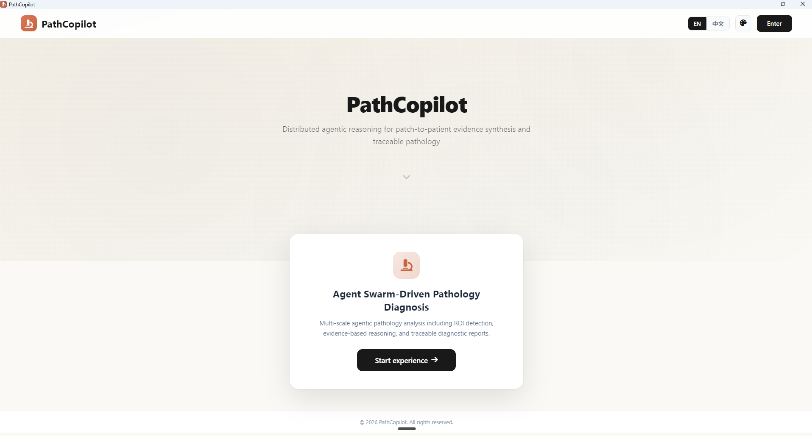

## 2. Optional appearance settings

Open **Settings → Appearance** to choose the warm, gray-white or high-contrast
workspace and an ROI palette. ROI level text remains visible so hierarchy is
not communicated by color alone.

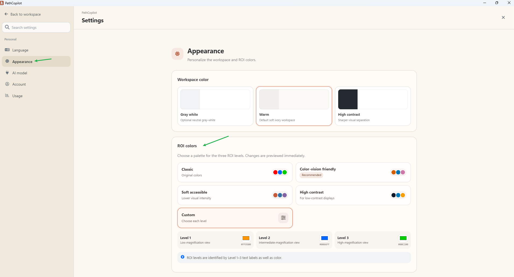

## 3. Configure an AI provider

Open **Settings → AI model** and enter:

1. the provider's complete OpenAI-compatible `/v1/chat/completions` URL;
2. the exact model identifier exposed by that provider. The model must support
   OpenAI-compatible Chat Completions and image input; prefer a multimodal model
   validated with PathCopilot;
3. one or more valid API keys issued by the same provider. Multiple keys can be
   used for concurrent requests and quota rotation; each key must have model
   permission and sufficient balance.

Select **Test Connection**. A successful test saves the form and updates the
active configuration banner. Never reveal an API key in a screenshot or commit
it to Git.

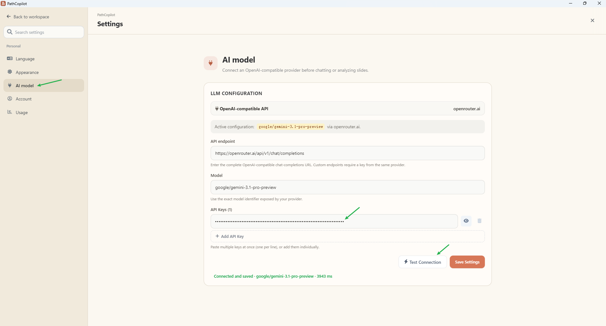

Examples:

- OpenRouter endpoint: `https://openrouter.ai/api/v1/chat/completions`

Model names are provider-specific; copy them exactly from the provider console.

## 4. Home chat and literature search

The home screen supports ordinary pathology questions without starting a WSI
workflow. When literature evidence is requested, PathCopilot may call its
bounded search tools and display source-linked results.

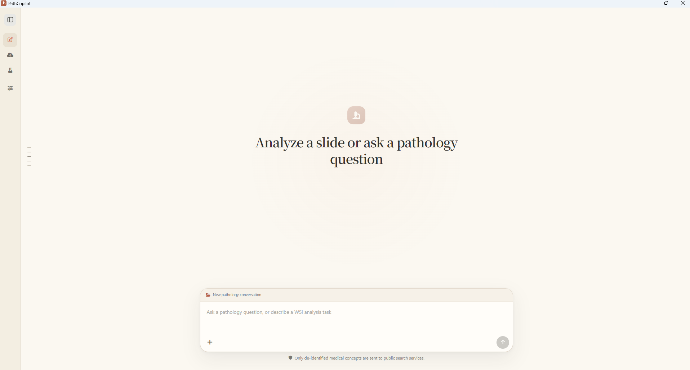

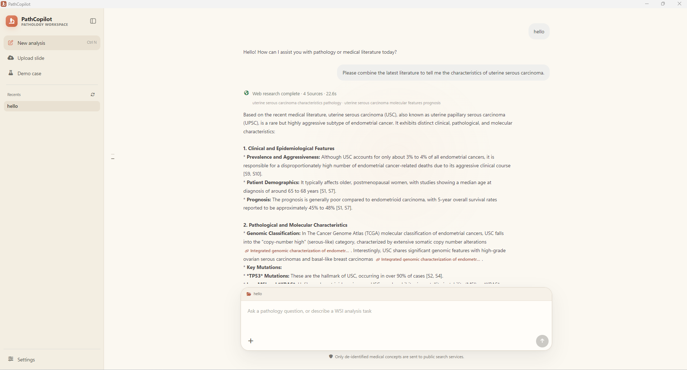

Do not include patient names, accession numbers or other direct identifiers in
queries sent to public search or model services.

## 5. Open a slide

Choose **Upload slide** for a local WSI. The EXE also contains a public TCGA
Demo case; the Git repository and CMD package do not bundle the SVS.

After loading, use the toolbar to zoom, return home, select regions, save state,
open files and capture a screenshot. The navigator at the lower right shows the
current viewport.

## 6. Ask a slide question and choose the route

Enter a question in the right-hand composer. If visual evidence is required,
PathCopilot asks before starting:

- **Agree · Use Agent Swarm:** continue to automatic or collaborative mode.
- **No · Use Single Agent:** use the independent sequential roaming route.
- **Cancel for now:** do not start slide analysis.
- **Patient Level:** create a patient case first, then upload multiple slides
  from the same patient. The application asks for the Agent route and
  collaboration policy when analysis starts.

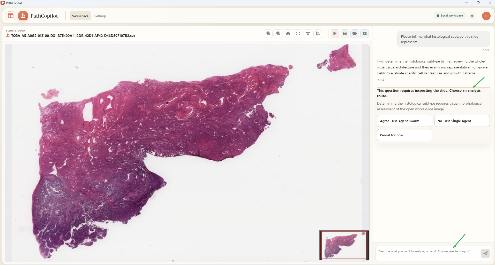

The primary Agent recommends a route; the user authorizes the actual execution.

## 7. Agent Swarm automatic mode

Automatic mode analyzes the whole-slide thumbnail, selects representative
first-level regions and dispatches nested Agents only where more evidence is
needed.

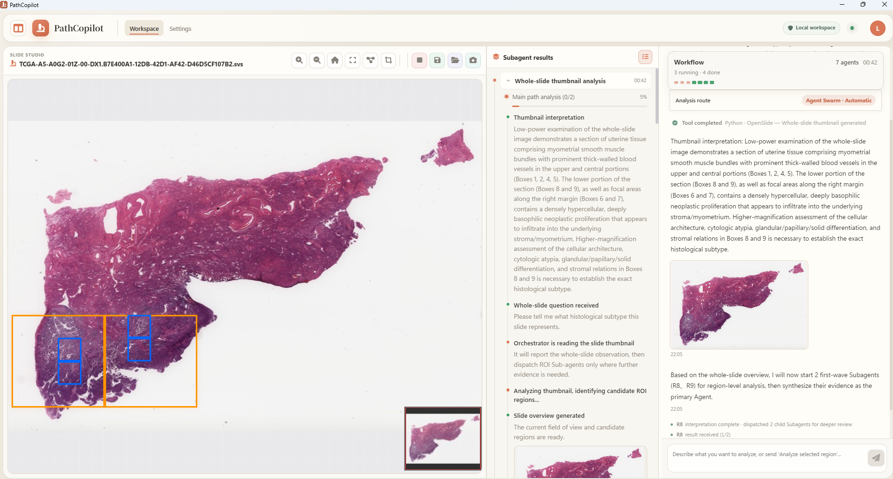

The viewer, Subagent results pane and Workflow pane update together. Nested
colored rectangles indicate progressively narrower fields; the text labels and
path IDs remain the authoritative hierarchy.

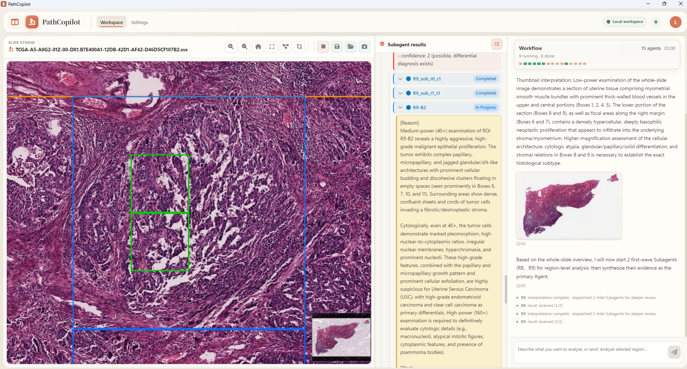

When all active paths settle, the Orchestrator writes the final answer with
evidence provenance and limitations.

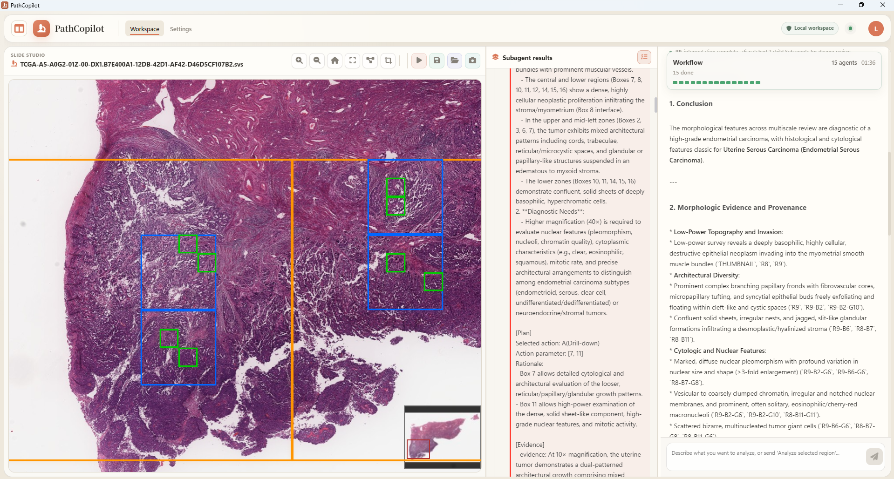

The completion card links to the HTML report and analysis tree.

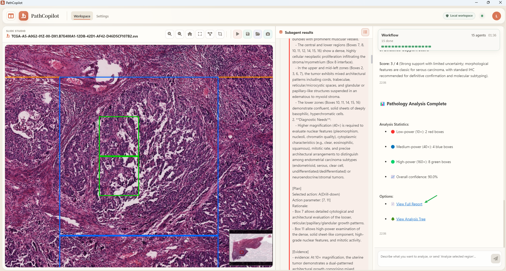

## 8. Reports and analysis tree

The HTML report includes the overview, ROI counts, representative fields,
Reason/Plan/Evidence text and the final synthesis.

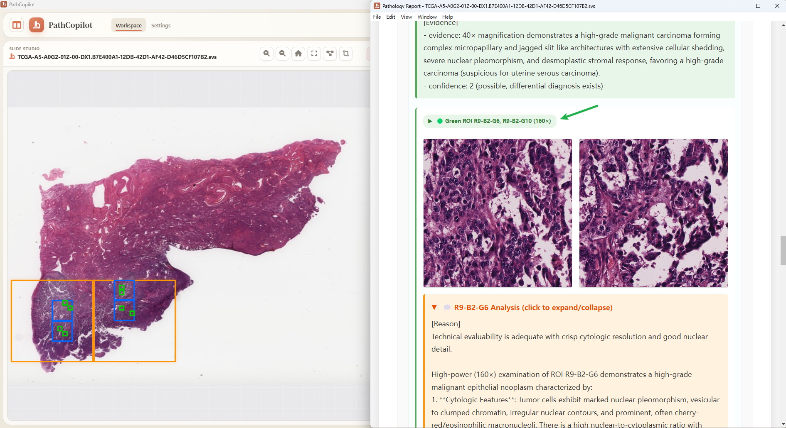

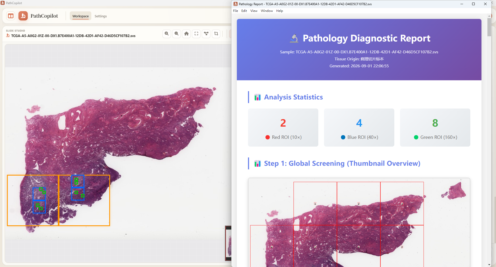

The visual tree connects the thumbnail, first-level regions and their nested
evidence. Select a node to inspect its image and reasoning.

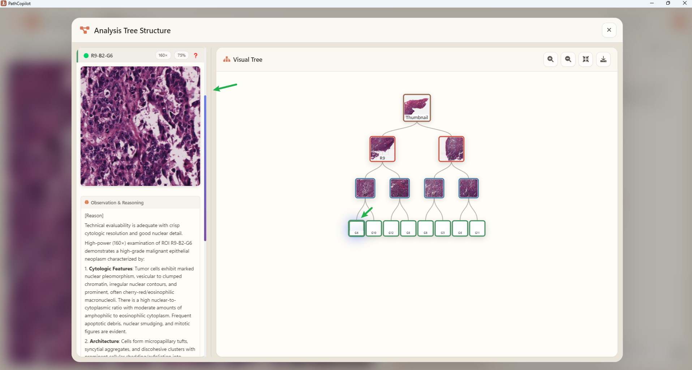

## 9. Manual screenshots and ROI questions

Use the camera button to save a high-definition workspace screenshot.

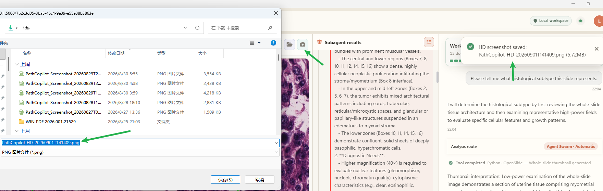

Right-click the slide to place an ROI, drag-capture a region, comment on the
view, or quote it into chat.

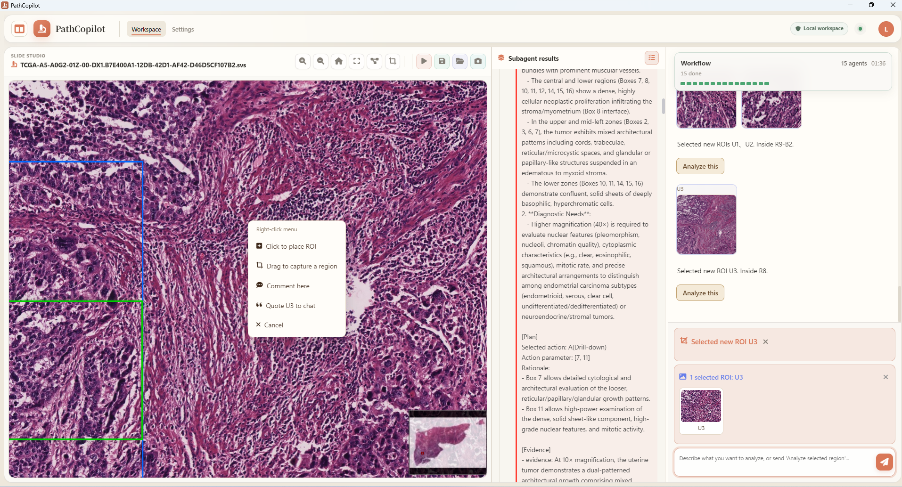

The selected region appears above the composer. Add a focused question and send
it; the region is cleared from the composer after submission.

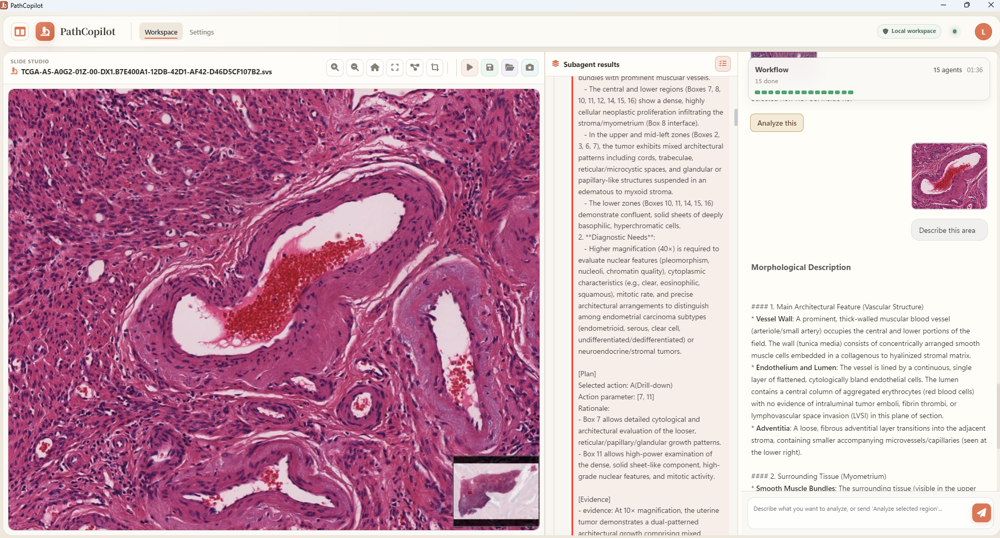

## 10. Other analysis modes

### Single Agent roam

The Single Agent visits one field at a time, reports every observation in chat
and moves the viewer to each selected field. It does not create an Agent Swarm
tree. Manual panning pauses automatic viewport following; select **Resume
automatic follow** to continue.

### Human–AI collaborative mode

Agent Swarm collaboration offers:

- **Approve every stage:** review each selection before the next level starts.
- **Final review only:** intermediate stages run automatically and pause before
  the final report.

Uncertain or report-relevant ROIs may be surfaced for review. Edits and quoted
feedback are retained as provenance.

### Patient Level

Create a patient case, upload all component slides, and choose serial or
parallel WSI execution. Automatic mode synthesizes after all slide workers
settle. Collaborative mode also requires the configured slide/report review
gates. Confirm that every slide belongs to the same case before starting.

## 11. Save, restore and local data

- The save button exports restorable analysis state and reports its path.
- Historical cases and chat threads remain local across reinstallations.
- EXE/CMD chat records are stored under
  `%LOCALAPPDATA%\PathCopilot\chat_threads`.
- To test a fresh account without permanent deletion, close PathCopilot and
  rename `chat_threads` to `chat_threads_backup`.

Do not delete the entire PathCopilot local-data folder unless uploads, settings,
caches and all history should also be removed.

## 12. Troubleshooting

### Connection test fails

- Confirm the endpoint ends in `/v1/chat/completions`.
- Use a key from the same provider as the endpoint.
- Copy the model name exactly from the provider marketplace.
- Check balance, quota, model permission, VPN and firewall.
- Retest after editing the settings. The current release accepts valid
  reasoning-model responses even when a short connection probe has empty text.

### Port 5000 is already in use

Close other PathCopilot/CMD instances and restart. Only one local server should
listen on `127.0.0.1:5000`.

### Windows shows an old icon

Unpin the old taskbar shortcut, install the latest artifact, and pin the newly
created shortcut. Explorer may cache an icon when the same filename is replaced.

### SmartScreen warning

The research installer is currently unsigned. Verify the SHA256 published in
`desktop/SHA256SUMS.txt` before running it.

## 13. Privacy checklist

- De-identify images and metadata before external transmission.
- Keep keys hidden and rotate any key exposed in a screenshot.
- Review the model provider's data-processing terms.
- Treat AI output as evidence-linked decision support, not an autonomous final
  diagnosis.

Continue exploring PathCopilot and open an Issue when you encounter a problem.
The paper evaluation code and the runnable CMD Web application source are
publicly available for review, improvement and research-oriented extension.
