# PathCopilot 简易使用指南

[English](README.md)

本指南适用于Windows EXE版和CMD桌面工作台。界面语言不同不会改变操作流程。

> PathCopilot目前仅为科研用途。切片选择、证据复核和最终结论仍由具备资质的病理医生负责。

## 1. 启动

- **EXE版：**安装GitHub Release中的安装包，双击桌面快捷方式。
- **CMD版：**首次运行`application-cmd/setup.cmd`，之后运行
`application-cmd/start.cmd`。

欢迎页可以切换中英文并进入工作台。

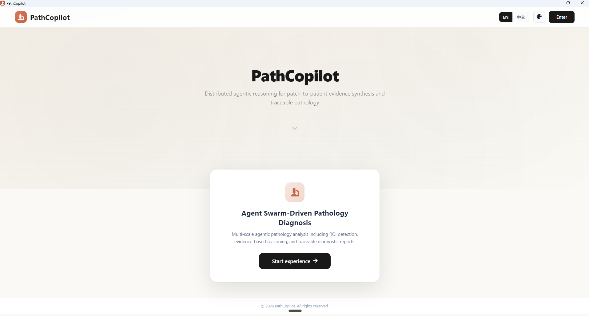

## 2. 外观设置

在 **Settings → Appearance** 中选择暖色、灰白或高对比度界面，也可以自定义您喜欢的ROI展示颜色。

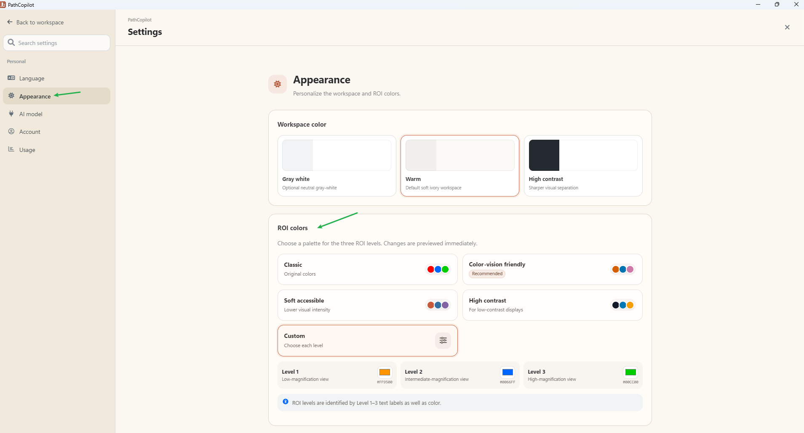

## 3. 配置AI模型

进入 **Settings → AI model**，填写：

1. 服务商完整的OpenAI兼容`/v1/chat/completions`地址；
2. 服务商提供的准确模型名称。模型需要兼容OpenAI Chat Completions和图像输入，建议优先使用经过PathCopilot验证的多模态模型；
3. 同一服务商签发的API Key。您可以添加同一服务商的多个有效Key，用于并发请求和额度轮换；请确保每个Key均具有对应模型权限和充足余额。

点击 **Test Connection**。测试成功会自动保存，并立即更新顶部当前配置。

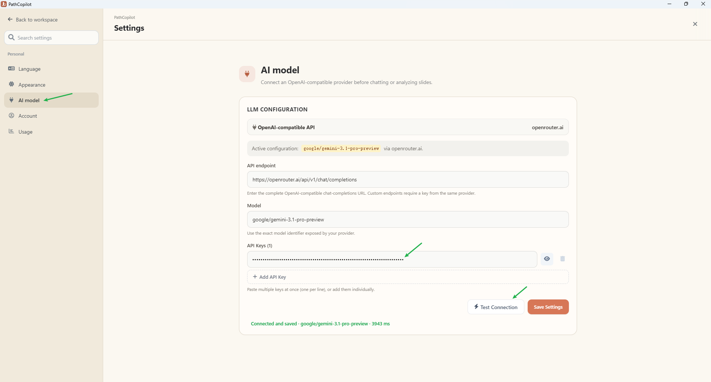

常用示例：

- OpenRouter：`https://openrouter.ai/api/v1/chat/completions`

模型名称必须从相应服务商控制台原样复制，在填入前您可以查看服务商对于此模型的使用说明。

## 4. 普通聊天与文献检索

首页可以直接询问病理知识，不会自动启动切片分析。需要最新文献时，系统可以调用检索工具并展示带来源的回答。

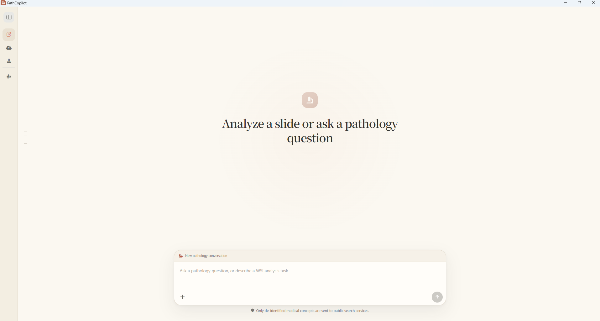

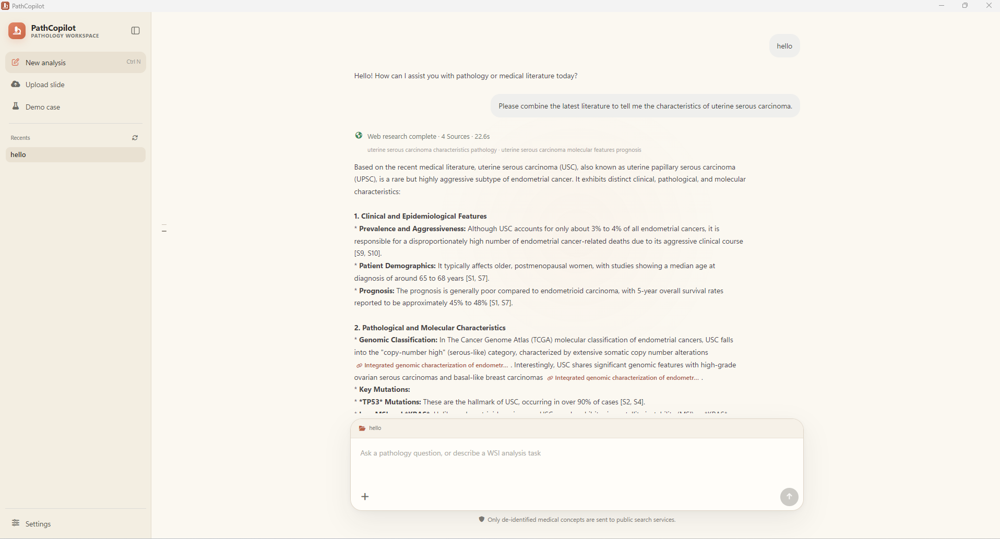

## 5. 打开切片

点击 **Upload slide** 加载本地WSI。EXE内置一张公共TCGA Demo；Git仓库和CMD版不包含SVS。

工作台工具栏支持缩放、回到全片、区域选择、保存状态、打开文件和高清截图。右下角导航器显示当前视野位置。

## 6. 提问并选择分析路线

在右侧输入切片问题。需要查看图像时，系统会先征求用户选择：

- **Agree · Use Agent Swarm：**继续选择自动或协作模式；
- **No · Use Single Agent：**进入独立单Agent游走；
- **Cancel for now：**暂不启动分析。
- **Patient Level：**通过“新建病例”进入Patient Level，再上传同一患者的多张切片；启动分析时系统同样会询问Agent路线和协作策略。

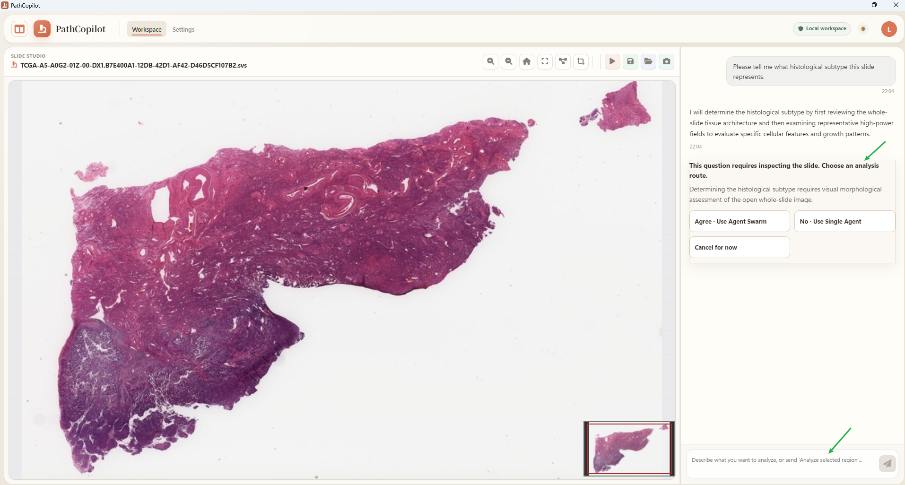

## 7. Agent Swarm自动模式

Agent Swarm会根据问题复杂度和当前证据，按需启动多个Subagent进行并行、多尺度下钻分析。

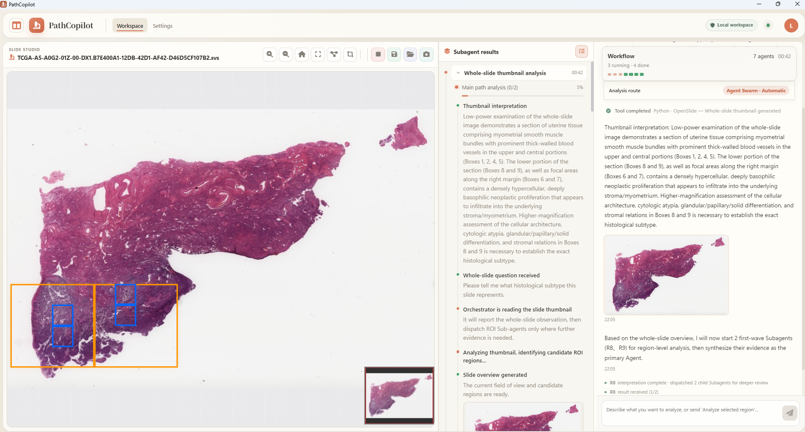

切片视野、Subagent结果和Workflow会同步更新。您可以点击屏幕对应区域，中间则会链接跳转到对应结果解读。

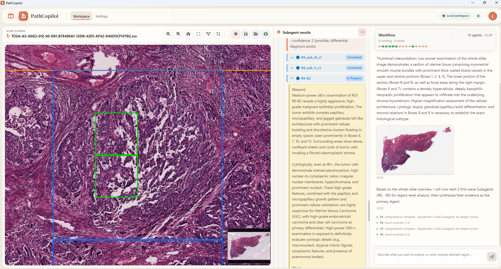

全部路径完成后，Orchestrator结合证据来源和局限性回答问题。

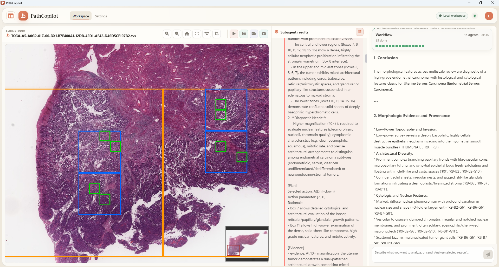

完成卡片可以打开HTML报告和分析树。

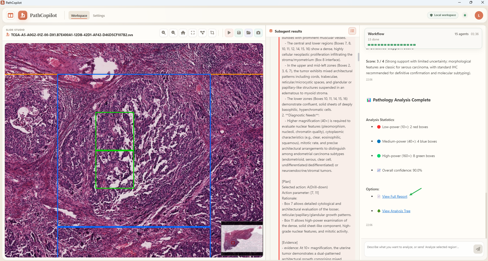

## 8. 报告与分析树

HTML报告包含全片概览、各层ROI、代表性视野、Reason/Plan/Evidence和最终综合。您可以展开或收起对应区域，定位感兴趣的路径和证据。

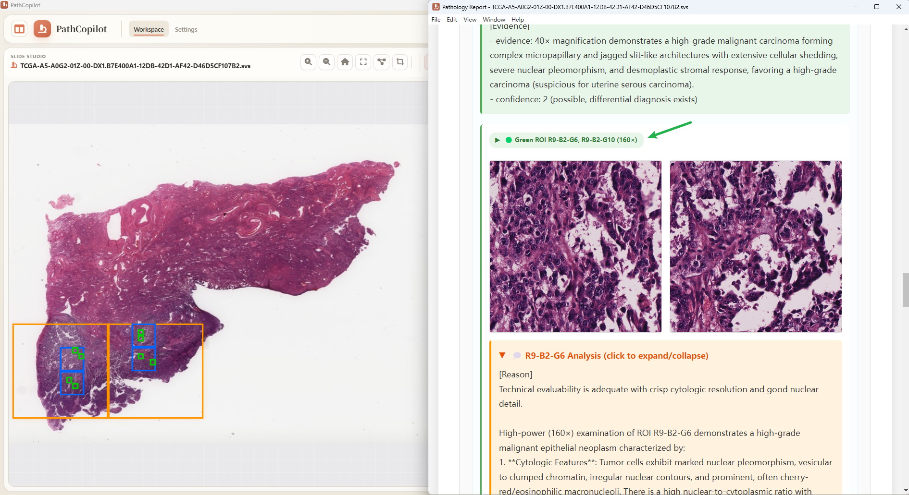

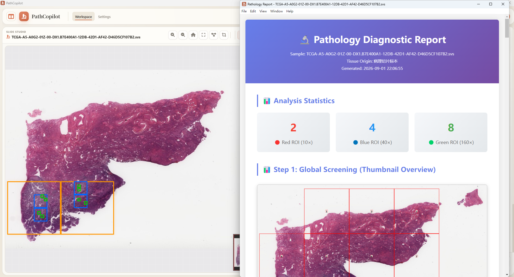

分析树连接缩略图、一级区域和下级证据。点击节点可以查看对应图片与推理。

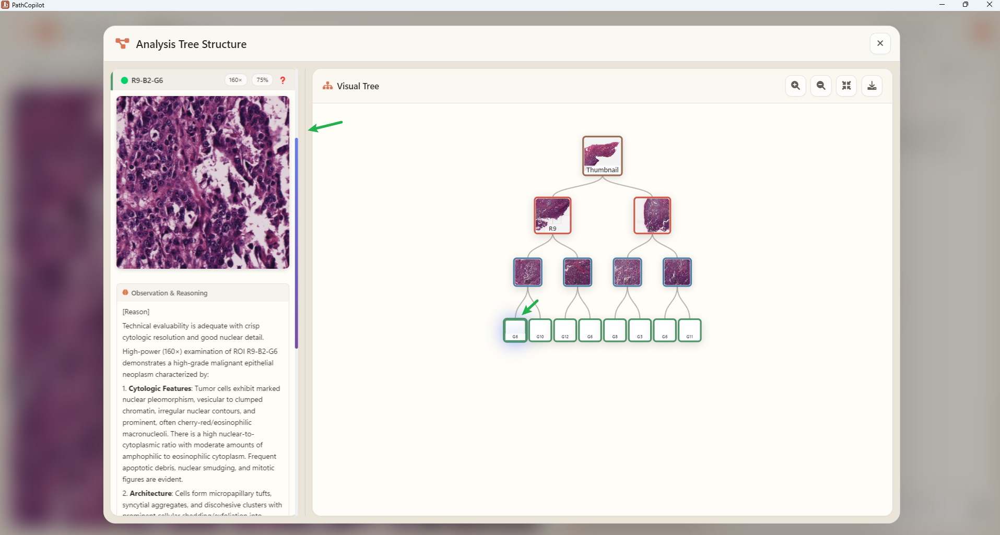

## 9. 高清截图和手动ROI追问

点击相机按钮保存高清工作台截图。

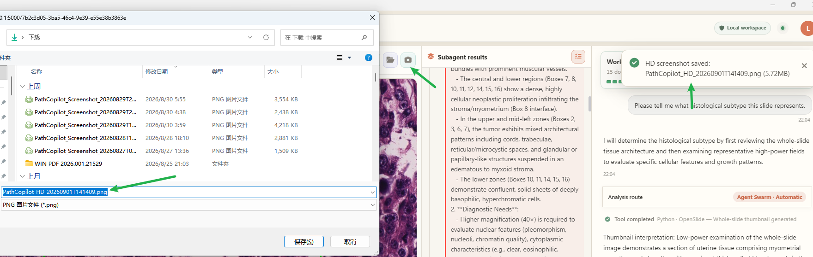

在切片上右键，可以放置ROI、拖动截图、评论当前视野或引用到聊天。

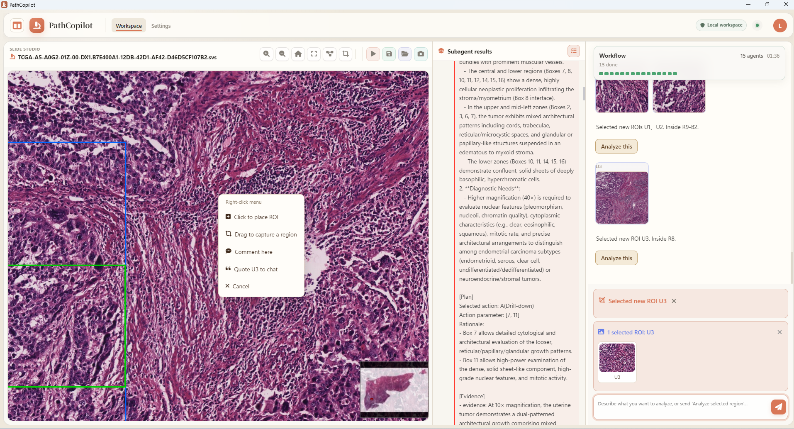

选中区域会显示在输入框上方。填写问题后发送，发送成功后该区域会从编辑器清除。

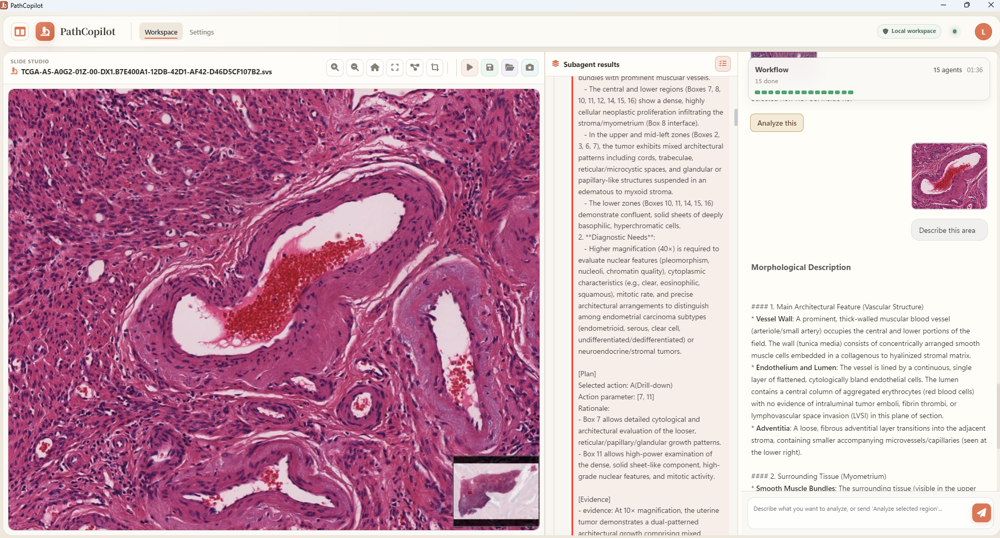

## 10. 其他分析模式

### 单Agent游走

单Agent每次只访问一个视野，在聊天区输出每一步观察，并自动移动切片视野。它不会
建立Swarm树。用户手动拖动切片会暂停自动跟随，可点击 **Resume automatic follow**
恢复。

### 人机协作模式

Agent Swarm协作提供：

- **每阶段批准：**每层选区都由用户批准后继续；
- **仅终末审阅：**中间阶段自动运行，在最终报告前统一审阅。

需要复核或与报告相关的ROI会进入审阅清单；人工编辑和引用反馈会保留来源记录。

### Patient Level

新建病例后上传同一患者的全部切片，再选择串行或并行。自动模式等待所有切片完成后
汇总；协作模式还会经过设定的切片和终报审阅。启动前必须确认所有切片属于同一病例。

## 11. 保存、恢复与本地记录

- 保存按钮导出可恢复的分析状态，并显示保存位置；
- 历史病例和对话默认在重装后保留；
- EXE和CMD的聊天记录位于  
`%LOCALAPPDATA%\PathCopilot\chat_threads`；

除非确定要同时清除设置、切片记录和缓存，否则不要删除整个PathCopilot本地目录。

## 12. 常见问题

### 模型连接失败

- 地址应以`/v1/chat/completions`结尾；
- Endpoint与Key必须来自同一服务商；
- 模型名称必须从服务商控制台原样复制；
- 检查余额、额度、模型权限、VPN和防火墙；
- 修改配置后重新测试连接。当前版本已经兼容推理模型在短测试中返回空文本的合法响应。

### 5000端口被占用

关闭其他PathCopilot或CMD实例后重新启动。同一时间只应有一个服务监听  
`127.0.0.1:5000`。

## 13. 隐私检查

- 传输前去除图像和元数据中的直接身份信息；
- API Key保持隐藏，截图暴露后及时轮换；
- 确认模型服务商的数据处理条款；
- AI输出只能作为有证据来源的辅助意见，不能替代最终病理诊断。

欢迎继续探索PathCopilot。我们公开了论文评测代码和CMD版可运行Web应用源码；如果您在使用中遇到问题，欢迎提交Issue、改进建议或开展研究用途的二次开发。
